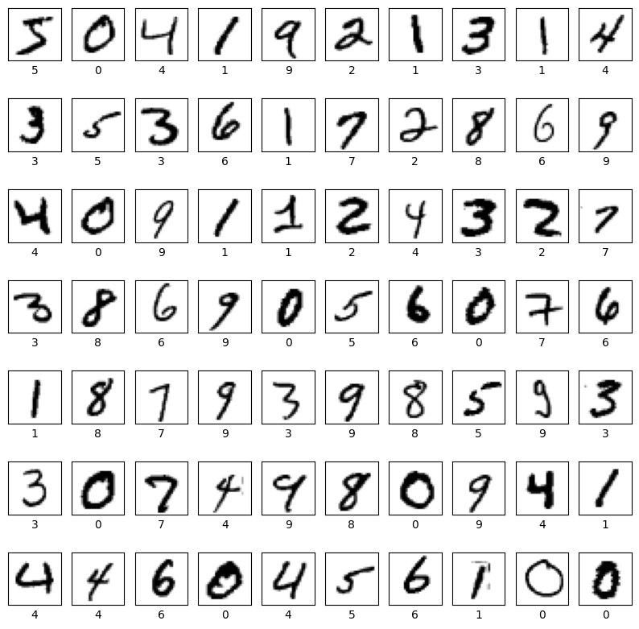

# Artificial Neural Networks

A collection of neural network implementations in TensorFlow/Keras, from single perceptrons to CNNs, transfer learning, autoencoders and GANs.



## Contents

### Fundamentals
| Notebook | Description |
|---|---|
| [perceptron_logic_gates](notebooks/01-fundamentals/perceptron_logic_gates.ipynb) | Hand-built perceptrons for AND, NOT, NAND and XOR, plus a Keras MLP that learns XOR |
| [linear_regression_keras](notebooks/01-fundamentals/linear_regression_keras.ipynb) | Regression on synthetic linear data with a small Keras network |
| [mnist_logistic_regression_vs_mlp](notebooks/01-fundamentals/mnist_logistic_regression_vs_mlp.ipynb) | Logistic regression vs. a neural network on MNIST |
| [mnist_gradient_descent_optimizers](notebooks/01-fundamentals/mnist_gradient_descent_optimizers.ipynb) | SGD, full-batch, mini-batch, Adagrad, momentum and Nesterov compared on MNIST |

### Convolutional Neural Networks
| Notebook | Description |
|---|---|
| [mnist_cnn_hyperparameter_tuning](notebooks/02-cnn/mnist_cnn_hyperparameter_tuning.ipynb) | CNN on MNIST with early stopping and a hyperparameter grid search |
| [cifar10_cnn](notebooks/02-cnn/cifar10_cnn.ipynb) | CNN image classifier on CIFAR-10 |
| [cifar10_inception_vgg16](notebooks/02-cnn/cifar10_inception_vgg16.ipynb) | Inception-style blocks and a VGG16 architecture built from scratch on CIFAR-10 |

### Transfer Learning
| Notebook | Description |
|---|---|
| [flowers_cnn_mobilenetv2_finetuning](notebooks/03-transfer-learning/flowers_cnn_mobilenetv2_finetuning.ipynb) | CNN on the TF Flowers dataset with data augmentation and dropout, then MobileNetV2 feature extraction and fine-tuning |
| [cifar10_mobilenetv2_transfer_learning](notebooks/03-transfer-learning/cifar10_mobilenetv2_transfer_learning.ipynb) | MobileNetV2 transfer learning on CIFAR-10 with augmentation |

### Autoencoders
| Notebook | Description |
|---|---|
| [mnist_autoencoders](notebooks/04-autoencoders/mnist_autoencoders.ipynb) | Basic, sparse (L1/L2), deep and convolutional autoencoders |
| [cifar10_denoising_autoencoder](notebooks/04-autoencoders/cifar10_denoising_autoencoder.ipynb) | Convolutional denoising autoencoder on CIFAR-10 |

### Generative Adversarial Networks
| Notebook | Description |
|---|---|
| [fashion_mnist_dcgan](notebooks/05-gans/fashion_mnist_dcgan.ipynb) | DCGAN that generates Fashion-MNIST clothing images |

### Project: Clothing Classification
[fashion_mnist_classifier](project/fashion_mnist_classifier.ipynb) trains a fully connected network on Fashion-MNIST.

## Repository Structure
```
├── notebooks/        # Topic-wise notebooks
├── project/          # Fashion-MNIST clothing classification project
├── models/           # Saved model weights (mnist_cnn.h5)
└── assets/           # Images used in this README
```

## Getting Started
```bash
pip install tensorflow numpy matplotlib scikit-learn pandas seaborn
jupyter notebook
```
All datasets (MNIST, Fashion-MNIST, CIFAR-10, TF Flowers) download automatically through Keras.
